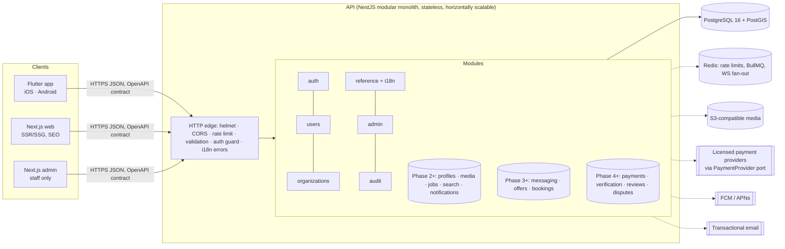

# 07 — Technical Architecture

## 1. Shape of the system

Solid boxes exist today; dashed integrations are ports with mock or no adapters (labelled in code).

## 2. Principles → concrete choices

| Principle | How it is applied |
|---|---|
| Modular monolith first | One deployable (`apps/api`). Each domain is a Nest module exposing services; no cross-module SQL on another module's tables except through read models (`MeQuery`). Splitting a module out later = moving its tables + replacing an in-process call with HTTP/queue. |
| API-first, shared contract | `packages/api-contract` holds enums, the permission matrix, DTO types, error codes and the generated `openapi.json`. Web/admin use `packages/api-client`; mobile mirrors it in Dart. CI fails when OpenAPI drifts. |
| Pure domain rules | `packages/domain` (no framework): money in minor units, offer/booking state machines, agreement snapshots, refund invariant. Unit-tested; the API will call these instead of re-implementing rules. |
| Localization from day one | `packages/i18n` is the single catalog for API errors, emails, web, admin and (via generated ARB) Flutter. See 13. |
| Deny by default | Global `AuthGuard` (every route authenticated unless `@Public()`), `StaffGuard` requiring an explicit `@RequireStaff(permission)`, object-level checks in services (404 for non-members, 403 for missing permission). |
| Deterministic schema | Forward-only SQL migrations with SHA-256 checksums and an advisory lock; edited migrations abort deploys. See 10. |
| Auditable | Append-only `audit_logs` (DB trigger forbids UPDATE/DELETE), written in the same transaction as the change. |
| Stateless app tier | JWT access tokens + DB-checked sessions; no in-process session state. Rate-limit storage moves to Redis before running >1 replica (backlog BUJ-1xx). |
| Honest integrations | Mail = `ConsoleMockMailer` (clearly labelled mock). Payments, push, SMS, malware scanning, AI translation: interfaces only, enabled via feature flags per country once contracted. |

## 3. Request lifecycle (API)

1. `pino-http` assigns/propagates `X-Request-Id`; sensitive fields are redacted from logs.
2. `helmet`, CORS allow-list, JSON body limit 256 kB.
3. `ThrottlerGuard` (default per-IP limit; stricter limit on credential endpoints).
4. `AuthGuard`: verifies HS256 JWT (issuer, audience, expiry) **and** that the session row is not revoked and the user is active.
5. Route guards (`StaffGuard`), `ValidationPipe` (whitelist + forbid unknown fields).
6. Service: object-level authorization → transaction → audit entry.
7. `HttpExceptionFilter`: stable `code` + message localized to account preference → `X-BUJ-Locale` → `Accept-Language` → English.

## 4. Data & infrastructure

| Concern | Choice | Status |
|---|---|---|
| OLTP | PostgreSQL 16, `citext`, `pgcrypto`, `postgis` | ✅ in use |
| Geo search | `geography(Point,4326)` + GiST index (onboarding location today; profiles/venues/jobs in Phase 2) | ✅ schema |
| Cache / queues | Redis 7 + BullMQ (notification fan-out, emergency requests, purge jobs) | ⏳ Phase 2 |
| Realtime | WebSocket gateway (Socket.IO + Redis adapter) | ⏳ Phase 3 |
| Media | S3-compatible, pre-signed uploads, async transcoding, malware scan hook, signed GET URLs | ⏳ Phase 2 |
| Search | Postgres FTS + PostGIS first; dedicated engine (OpenSearch/Meilisearch) only when measured need | ⏳ Phase 2 |
| Observability | Structured JSON logs now; OpenTelemetry traces/metrics in 18 | ⏳ |

## 5. Phase plan (engineering view)

| Phase | Scope | Status |
|---|---|---|
| 1 Foundation | Architecture, schema, auth, i18n, roles/orgs, design system, core API, web/admin/mobile shells | **Implemented in this repo** (see README for gaps) |
| 2 Marketplace | Musician/band/venue profiles, media portfolios, jobs & applications, search, notifications | Planned |
| 3 Communication & Offers | Messaging, offers/counter-offers (domain rules already exist), availability, booking requests & lifecycle, emergency requests | Planned |
| 4 Payments & Trust | Licensed PSP integration, verification workflows, payouts, refunds, disputes, booking-linked reviews | Planned; blocked on provider/legal decisions |
| 5 Events & Community | Events, meetups, RSVP, event chat, community discovery | Planned |
| 6 Challenges & Growth | Challenges, anti-bot voting, moderation at scale, sponsorship, premium/digital purchases (app-store billing) | Planned |
