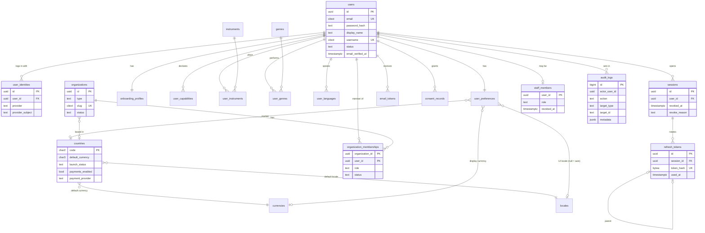
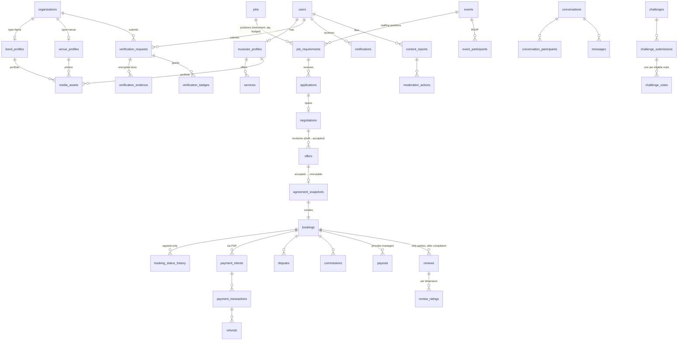

# 09 — Entity Relationship Diagram

## 9.1 Implemented (Phase 1 — migrations 0001–0007)

Enforced invariants: unique email (case-insensitive), one identity per (provider, subject), quiet-hours pair, payments require a contracted provider (`CHECK`), every organization keeps ≥1 active owner (deferred constraint trigger), `audit_logs` and `consent_records` append-only (triggers), refresh/email tokens stored only as SHA-256 hashes.

## 9.2 Planned domain model (Phases 2–6)

Party model for marketplace tables: a **party** is either a user (`party_type='user'`) or an organization (`party_type='organization'`), so offers/bookings/reviews work identically for a solo musician, a band, a venue or an agency. Financial tables follow docs/15 invariants (bigint minor units, ISO-4217, settlement currency = snapshot currency, append-only histories, provider event IDs unique).
