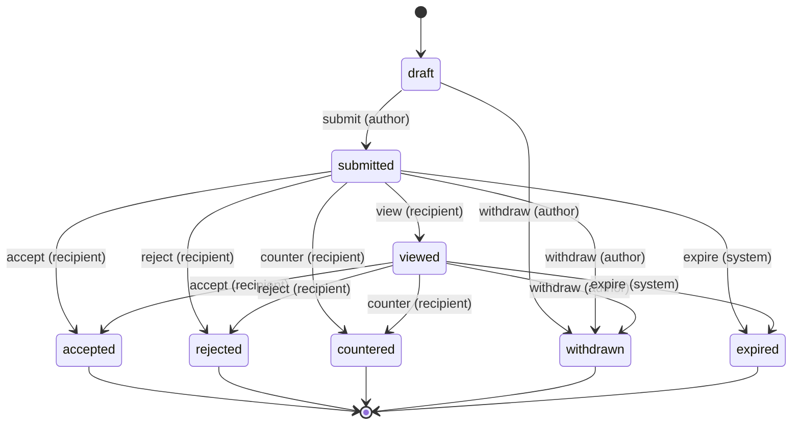
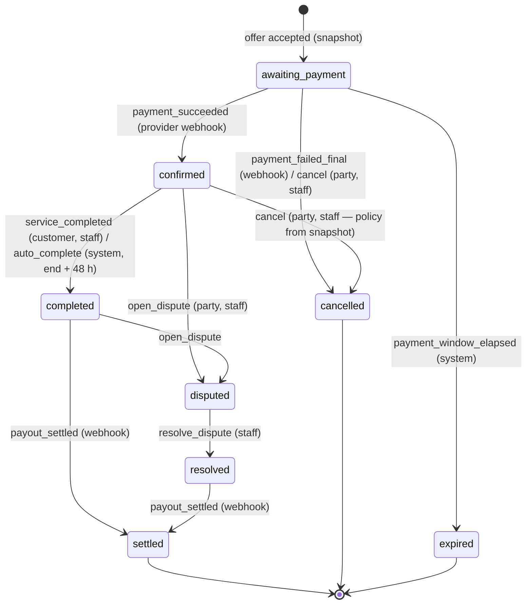

# 14 — Negotiation & Booking State Machines

Executable source: [`packages/domain/src/offer.ts`](../packages/domain/src/offer.ts), [`booking.ts`](../packages/domain/src/booking.ts) — the tables below mirror `OFFER_TRANSITIONS` / `BOOKING_TRANSITIONS`.

## Offer (one revision of a negotiation)

Rules (unit-tested):
- A **counter** closes the open revision (`countered`) and creates a new `submitted` revision authored by the former recipient. Exactly one open revision per negotiation.
- Currency cannot change within a negotiation; price must be > 0.
- Terminal states accept no actions; drafts cannot be accepted; only the recipient accepts/rejects/counters; only the author withdraws.
- **Acceptance** produces a deep-frozen `AgreementSnapshot` (parties, service, price+currency, start/end + IANA zone, venue, equipment responsibilities, travel expenses, cancellation policy, payment conditions) and its SHA-256 over canonical JSON. Later edits to the job listing never change it; the hash is re-verified before payment, payout and dispute handling.

Worked example (test `negotiation: 12,000 budget → …`): venue budget 12,000 TRY → band offer 14,000 → venue counter 12,500 → band accepts → snapshot price `1250000` minor units TRY.

## Booking

Rules (unit-tested): clients and staff can never mark a payment as succeeded (only verified provider webhooks); performers cannot self-complete; disputes resolve only by staff; auto-completion requires end time + grace and no dispute; reviews only for completed/resolved/settled bookings, by a party, about the other party; Σ refunds ≤ captured amount in the capture currency.

Persistence (Phase 3/4): `bookings.status` + append-only `booking_status_history(from, to, event, actor, at, metadata)`; transitions run in a transaction with `SELECT … FOR UPDATE`, and the domain function decides validity — the database stores the result and a CHECK limits values.

Fund-holding semantics depend on the licensed provider and jurisdiction (docs/15): the state machine models *what the platform knows*, not custody of money.
